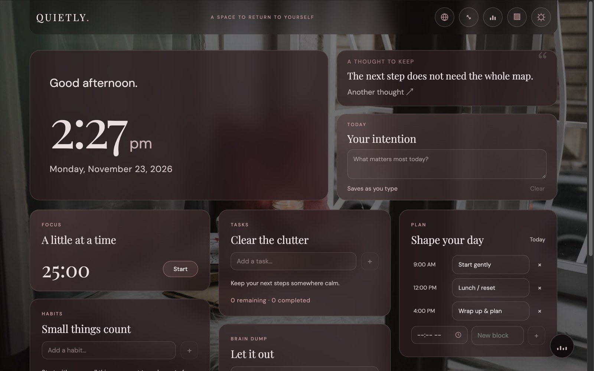
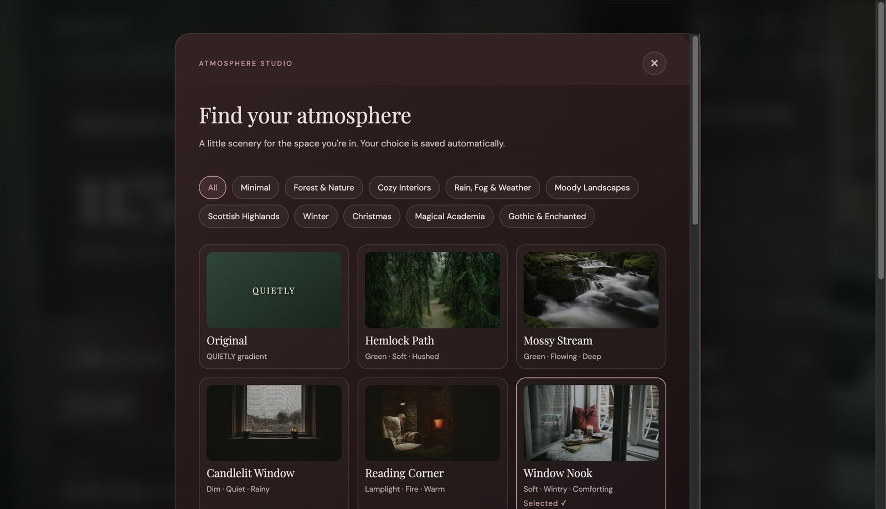
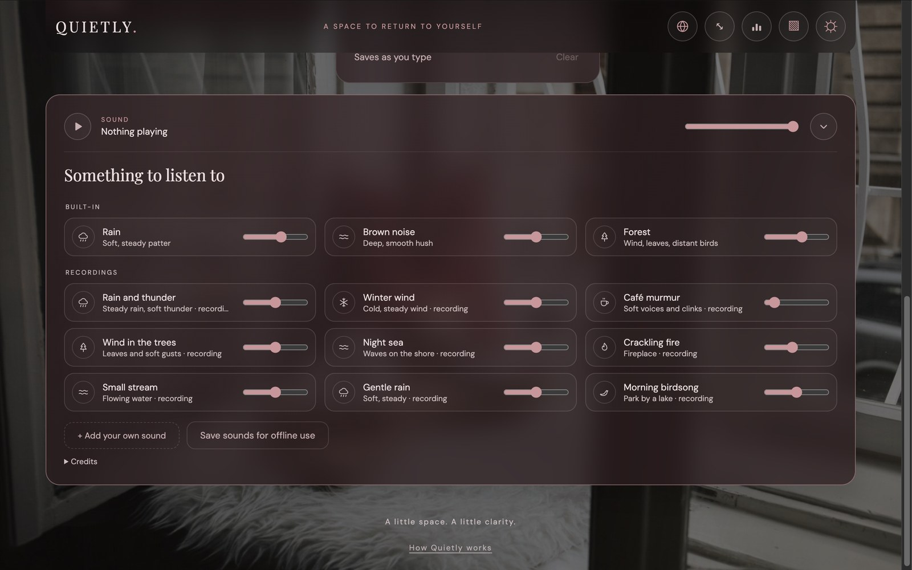

# Quietly.

A calm, private space to return to yourself. A free, open-source focus dashboard:
clock, daily intention, focus timer, habits, tasks, a gentle plan for the day,
a brain-dump, ambient sounds and a library of quiet backgrounds.

Everything stays in your browser. There is no account, no server and no tracking.

Made by Jigyasa Ahuja.

**Try it live: https://quietly-focus.pages.dev**



| | |
|---|---|
|  |  |

## Features

- Focus timer (25 / 5 / 15 minutes, adjustable) that keeps running while you use the rest of the app,
  with a gentle chime when it ends (and an optional desktop notification)
- Daily intention, habits that reset each day, tasks, brain dump
- A gentle plan for the day with editable blocks
- Sound mixer: synthesised rain, brown noise and forest, plus nine real recordings,
  and your own audio files (kept in your browser only). A button saves all the recordings
  on your device so they keep playing without internet
- A small round sound button in the corner (animated bars while sound plays) with play/pause
  and an overall volume; open the full mixer when you want more
- A calm Stats window: focus minutes for the last seven days, your current streak and a
  total, kept only on your device and easy to clear
- A short "How Quietly works" note explaining that nothing leaves your device
- 9 colour themes and 19 background photos; the "Auto" theme adapts the colours to the photo
- Seven languages: English, Español, Français, Deutsch, Português, Italiano, हिन्दी
- Installable as an app, and works offline

## Keyboard shortcuts

| Key | What it does |
|---|---|
| Space | Start the focus timer, or open it if it is already running. Inside the timer window: pause or resume |
| + / - | Make the timer longer or shorter by a minute (only while it is paused) |
| 1 / 2 / 3 | Switch between Focus, Short break and Long break (only while the timer is stopped or paused) |
| R | Reset the focus timer (when the timer window is open) |
| B | Open or close the Atmosphere Studio (backgrounds) |
| T | Open or close the Theme Studio |
| S | Open or close your Stats (focus time this week, streak) |
| M | Pause or resume your sounds (brings back the same mix) |
| N | Show or hide the full sound mixer |
| F | Enter or leave fullscreen |
| Esc | Close any open window (a running timer keeps running) |

The shortcuts do not trigger while you are typing in a box. In fullscreen, the browser uses
the first Esc press to leave fullscreen, so press Esc again to close a window.

## Run it on your computer

You need [Node.js](https://nodejs.org) (version 18 or newer).

```bash
npm install
npm run dev
```

Open the address it prints (usually http://localhost:5173).

## Build and host it yourself

```bash
npm run build
```

This creates a `dist` folder. Upload the contents of `dist` to any static host
(GitHub Pages, Netlify, Cloudflare Pages, your own server). To try the build locally:

```bash
npm run preview
```

Notes for hosting:

- Serve it from the **root** of a domain or subdomain (for example `https://quietly.example.com/`).
  Hosting in a sub-folder needs the paths in `public/manifest.webmanifest`, `public/sw.js`
  and `index.html` changed.
- It must be served over HTTPS (localhost is fine for testing) for install and offline to work.

## Install it as an app

Open the live site, then use the install icon in Chrome's address bar, or
"Add to Home Screen" on iPhone. Install first, then use only the app, because each
device and browser keeps its own separate, private copy of your data.

## Your data

Tasks, notes, settings and your own sounds are saved in your browser (localStorage and IndexedDB).
They are tied to the exact address you use, so `localhost:5173` and your hosted site are separate.
Clearing "site data" in your browser deletes them.

## Adding or fixing a translation

All text lives in `src/i18n.js`. Each language is one block of lines like
`'tasks.title': 'Clear the clutter'`. Copy the English block, translate the right-hand side,
and keep any `{placeholders}` exactly as they are. The translations were written by an AI
assistant and have not all been reviewed by native speakers, so corrections are very welcome.

## Credits and licences

- Code: MIT, copyright Jigyasa Ahuja, see [LICENSE](LICENSE).
- Background photos: see `public/backgrounds/CREDITS.txt` (Unsplash and Pexels, free to use and redistribute).
- Sound recordings: see `public/sounds/CREDITS.txt` (Pixabay Content Licence and CC BY 4.0).
- Fonts: DM Sans and Playfair Display (SIL Open Font License) via Fontsource.
